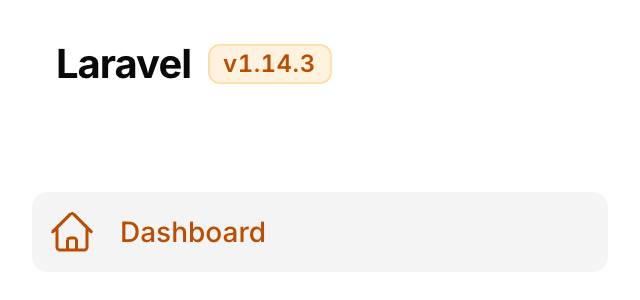

# Filament App Version

[](https://packagist.org/packages/vaslv/filament-app-version)
[](https://github.com/vaslv/filament-app-version/actions/workflows/tests.yml)
[](https://plumbphp.dev/vaslv/filament-app-version)

**English** · [Русский](README.ru.md)

A [Filament 5](https://filamentphp.com) plugin that shows your application's version as a small chip next to the panel logo — in the topbar on desktop and in the sidebar drawer header on mobile, so it is visible at any width.


- 🔗 **Works with no configuration** — if your app already exposes `config('app.version')` or carries a `version` field in `composer.json`, install and register the plugin and you are done
- 🧩 **Several sources, one priority chain** — the first non-empty one wins
- 🎨 **Takes its colour from your panel** — the primary colour by default, the neutral grey on request, in both light and dark themes, with no custom theme and no Tailwind rebuild
- 🔒 **Hidden from guests by default** — a build number on a public login page is a free hint to anyone looking up CVEs; showing it is one explicit method call

## Requirements

- PHP 8.4+
- Laravel ^13.0
- Filament ^5.0

## Installation

```bash
composer require vaslv/filament-app-version
```

Register the plugin in your panel provider:

```php
use Vaslv\FilamentAppVersion\AppVersionPlugin;

public function panel(Panel $panel): Panel
{
    return $panel
        // ...
        ->plugin(AppVersionPlugin::make());
}
```

That is the whole setup. Publish the config only if you need to change the chain:

```bash
php artisan vendor:publish --tag=filament-app-version-config
```

## Where the version comes from

Sources are tried in order and the **first non-empty one wins**:

```
1. config('filament-app-version.version')   ← env('APP_VERSION'), the CI injection point
2. config('app.version')                    ← the Laravel convention
3. composer.json → "version"
→  fallback 'dev'
```

To keep the version in the repository instead, add a `version` field to your application's `composer.json` and bump it at release time — that is link 3, and nothing else is needed.

### Injecting the version from CI

Set `APP_VERSION` in your environment and the first link of the chain picks it up:

```
APP_VERSION=1.19.16
```

**Do not** reach for `EnvVersionResolver` for this. The package config file calls `env('APP_VERSION')` *inside a config file*, which is the only placement that survives `php artisan config:cache` — with a cached config Laravel never loads `.env`, so an `env()` call at runtime returns `null` in production while working fine on your laptop.

## Configuration

```php
use Filament\Panel;
use Filament\Support\Enums\Size;
use Filament\Support\Enums\VerticalAlignment;
use Filament\View\PanelsRenderHook;
use Vaslv\FilamentAppVersion\AppVersionPlugin;
use Vaslv\FilamentAppVersion\Resolvers\ConfigVersionResolver;
use Vaslv\FilamentAppVersion\Resolvers\FileVersionResolver;
use Vaslv\FilamentAppVersion\Resolvers\GitVersionResolver;

->plugin(
    AppVersionPlugin::make()
        ->resolvers([
            ConfigVersionResolver::make('app.release'),
            FileVersionResolver::make(base_path('VERSION')),
            GitVersionResolver::make(),
        ])
        ->fallback('dev')
        ->prefix('v')
        ->badge()
        ->neutral()
        ->size(Size::Small)
        ->verticalAlignment(VerticalAlignment::Center)
        ->renderHooks([
            PanelsRenderHook::TOPBAR_LOGO_AFTER,
            PanelsRenderHook::SIDEBAR_LOGO_AFTER,
        ])
        ->tooltip(fn (): string => __('Application version'))
        ->visible(fn (Panel $panel): bool => auth()->user()?->can('viewAppVersion') ?? false)
        ->view('filament.my-own-chip')
        ->extraAttributes(['data-testid' => 'app-version']),
)
```

| Method | Default | Notes |
|---|---|---|
| `resolvers(array)` | the global chain | Overrides the chain **for this panel's chip only** |
| `fallback(?string)` | `'dev'` | `null` renders no chip at all when nothing resolves |
| `prefix(string)` | `'v'` | Never doubled: a version that already starts with `v` is left alone |
| `badge(bool)` | `false` | Draws the version as a pill with a tint and a hairline ring instead of bare text |
| `neutral(bool)` | `false` | Uses the panel's neutral grey instead of its primary colour |
| `size(Size\|string)` | `Size::Medium` | `xs` … `xl`. Scales the text, and the pill along with it — see [Size](#size) |
| `verticalAlignment(VerticalAlignment\|string)` | `VerticalAlignment::Center` | `start`, `center` or `end` — see [Vertical placement](#vertical-placement) |
| `renderHooks(array)` | topbar + sidebar header | Any `PanelsRenderHook` — see [Hook order](#hook-order) |
| `tooltip(string\|Closure\|null)` | translated "Application version" | Becomes the `title` attribute. `null` removes it entirely rather than falling back to the default. Pass a **closure** if the text is translated — see below |
| `visible(bool\|Closure)` | authenticated only | Has the last word, over the default and over `showToGuests()` |
| `showToGuests(bool)` | `false` | See [Visibility](#visibility) |
| `view(string)` | package chip | See [Custom view](#custom-view) |
| `extraAttributes(array)` | `[]` | `style` is concatenated with the package's, everything else overrides — see below |

Closures passed to `visible()` and `tooltip()` receive the `Panel` as their first argument; zero-argument closures keep working.

Pass a closure to `tooltip()` whenever the text is translated. A panel provider runs once, before the locale middleware and once per Octane worker, so a bare `__()` freezes one language for every user.

### Appearance

By default the chip is bare text in the panel's **primary** colour — the same one Filament uses for the active menu item. Two switches change that:

```php
AppVersionPlugin::make()->badge()     // a pill: tinted background + hairline ring
AppVersionPlugin::make()->neutral()   // the grey of an ordinary menu item
```

| | Light | Dark |
|---|---|---|
| default |  |  |
| `neutral()` |  |  |
| `badge()` |  |  |
| `badge()->neutral()` |  |  |

The panel above passes `Color::Amber` to `->colors()`; the chip is amber because the panel is, not because the package picked a colour.

`prefix()` is part of the same text — a `v` unless you say otherwise:

```php
AppVersionPlugin::make()->badge()->prefix('build ')
```


Nothing is hard-coded. The colours come from the panel's own `--primary-*` and `--gray-*` variables, so the chip follows whatever palette you passed to `->colors()`. The light and dark shades are picked by CSS `light-dark()`, which works because Filament declares `color-scheme` on the dark root — so there is no class to register and no stylesheet to rebuild.

### Size

```php
use Filament\Support\Enums\Size;

AppVersionPlugin::make()->size(Size::Small)   // or ->size('sm')
```

Takes Filament's own `Size` or its string value.

| `size()` | Text | Pill, `badge()` only |
|---|---|---|
| `xs` | `0.625rem` / `0.875rem` | padding `0 0.25rem`, radius `0.25rem` |
| `sm` | `0.6875rem` / `1rem` | padding `0.0625rem 0.375rem`, radius `0.25rem` |
| `md` **(default)** | `0.75rem` / `1rem` — Tailwind's `text-xs`, the size Filament's own `.fi-badge` uses | padding `0.125rem 0.5rem`, radius `0.375rem` |
| `lg` | `0.875rem` / `1.25rem` — `text-sm` | padding `0.25rem 0.625rem`, radius `0.375rem` |
| `xl` | `1rem` / `1.5rem` — `text-base` | padding `0.375rem 0.75rem`, radius `0.5rem` |

All five with `badge()` on, cropped identically so the steps are comparable:

| | |
|---|---|
| `xs` |  |
| `sm` |  |
| `md` |  |
| `lg` |  |
| `xl` |  |

`md` is exactly what the chip was before `size()` existed, so upgrading changes nothing until you call it. Every padding is a Tailwind spacing token; two of the radii are Filament's own — `rounded-md` on the badge-sized steps and the button's `rounded-lg` at the top — and the bottom two are Tailwind's `rounded-sm`, one step under the badge, because `0.375rem` on a `0.625rem` line reads as a lozenge. The two steps below `md` leave the Tailwind type scale, which bottoms out at `text-xs`, because "smaller than a badge" is the whole point of asking for `xs` next to a logo.

Without `badge()` only the text scales: there is no pill to scale.

### Vertical placement

```php
use Filament\Support\Enums\VerticalAlignment;

AppVersionPlugin::make()->verticalAlignment(VerticalAlignment::Start)   // or ->verticalAlignment('start')
```

`start` pins the chip to the top, `end` to the bottom, `center` is the default. The three below are the sidebar drawer header, where the box is a fixed `4rem` and the difference is at its widest:

| | |
|---|---|
| `start` |  |
| `center` **(default)** |  |
| `end` |  |

The reference is **the row the chip renders into**, not the whole bar. In the topbar that row is as tall as the logo, so `start` levels the chip with the top of the logo. The sidebar drawer header is a fixed `4rem` (`.fi-sidebar-header` is `h-16`), so there `start` and `end` hug the header's own edges — the same setting is tighter on desktop than it is in the mobile drawer.

`center` adds nothing to the markup at all: it renders exactly what the chip rendered before this method existed, and the container goes on placing it — which in both default hooks is the middle. Only `start` and `end` write anything, because nothing but `align-self` can move an item off its container's `align-items`.

They write it twice, as `align-self` and as `vertical-align`, because the hook decides which one is live. A hook lands the chip in one of three kinds of container: a **flex row** (`.fi-topbar-start` and `.fi-sidebar-header`, the two defaults), a **grid** (every schema hook, `AUTH_LOGIN_FORM_AFTER` among them — Filament renders a schema container through its own `grid()` macro), or a **block**, which is a hook of your own rendering into running text. In the first two `align-self` moves the chip and `vertical-align` is inert; in the third it is the other way round. Each declaration is a no-op where the other one works.

There is a fourth container, and it is the one caveat: a **flex column** — `.fi-sidebar-nav` and `.fi-sidebar`, which carry `SIDEBAR_NAV_START`, `SIDEBAR_NAV_END`, `SIDEBAR_START` and `SIDEBAR_FOOTER` — reads `align-self` on the *horizontal* axis. On those hooks `start` and `end` move the chip sideways rather than up and down. That is the axis CSS gives them, not a decision this package can make; it is also why `center`, the value every chip has without asking for it, writes nothing.

An unrecognised string in either method is ignored — the previous value stays — with a warning in the log when `APP_DEBUG` is on. A mistyped size is a cosmetic detail, and the package does not take a panel down over one.

### `extraAttributes()` and escaping

Values and attribute names you pass here reach the HTML **unescaped** — Laravel's own `ComponentAttributeBag` behaviour, which this package does not diverge from. A value carrying a double quote closes the attribute, so escape anything that is not a literal you wrote yourself.

```php
// Fine — a literal.
->extraAttributes(['data-testid' => 'app-version'])

// Escape it — the value comes from outside your code.
->extraAttributes(['data-tenant' => e($tenant->name)])
```

`style` is the restyling route that needs no custom view — here a monospaced chip, still a `badge()` in the panel's own colour:

```php
->badge()->extraAttributes(['style' => 'font-family:ui-monospace,SFMono-Regular,monospace;letter-spacing:0.02em'])
```


Two exceptions: `style` is folded into the package's own merged default and Laravel escapes it for you, and `tooltip()` goes through the escaped path, so `->tooltip($somethingUntrusted)` is safe.

### Sources

| Resolver | Reads |
|---|---|
| `ConfigVersionResolver::make('app.version')` | A config value by dot path |
| `ComposerJsonVersionResolver::make()` | The `version` field of the application's `composer.json` |
| `FileVersionResolver::make(base_path('VERSION'))` | A plain-text file. A second argument — `make(base_path('build.json'), 'version')` — switches it to JSON with a dot path |
| `GitVersionResolver::make()` | The seven-character SHA of `HEAD`, read straight out of `.git` with no shell calls and no tag detection |
| `CallbackVersionResolver::make(fn () => …)` | Anything — Redis, Vault, a table |
| `EnvVersionResolver::make('APP_RELEASE')` | A **process** environment variable — read the warning below |

`EnvVersionResolver` only sees a variable that really is in the process environment: compose's `environment:`/`env_file:`, a Kubernetes Deployment, a systemd unit. A variable that lives only in a `.env` file is invisible to it once the config is cached, which is why the supported route for an environment variable is the package config file.

### Visibility

|  | guest | authenticated |
|---|---|---|
| default | hidden | shown |
| `showToGuests()` | shown | shown |
| `visible(fn)` | the closure's result | the closure's result |

Setting `visible()` together with `showToGuests()` logs a warning when `APP_DEBUG` is on, so the contradiction surfaces rather than being guessed at.

The default is conservative because hooks such as `AUTH_LOGIN_FORM_AFTER` render before login, where a precise build number tells an attacker which CVEs to try.

### Hook order

The two default hooks are complementary by **breakpoint**, not by menu state: above `64rem` Filament hides the sidebar header, below it the topbar. So the topbar chip is what you see on desktop, the sidebar one after opening the drawer on mobile, and on desktop the sidebar copy sits in the DOM without being painted.

| `TOPBAR_LOGO_AFTER` — desktop | `SIDEBAR_LOGO_AFTER` — the mobile drawer |
|---|---|
|  |  |

On the sidebar hook the package emits one CSS rule alongside the chip. Filament gives that header's logo container `flex: 1 1 0%`, and `SIDEBAR_LOGO_AFTER` is the header's last child, so without it the chip lands against the opposite edge instead of next to the logo. The rule travels with the chip — nothing on other hooks, nothing when the chip is hidden, and no stylesheet to rebuild — and it selects the chip through `data-filament-app-version`, an attribute every chip carries and your own CSS or tests are free to use.

Output on a shared hook follows **registration order**, so where `->plugin()` sits in your panel provider chain decides whether the chip lands before or after another plugin's output on the same hook:

```php
->plugin(AppVersionPlugin::make())      // logo → version → menu
->plugin(TopbarMenuPlugin::make())
```

Swap those two lines and you get logo → menu → version.

### Custom view

`->view()` replaces the chip entirely. Your view receives exactly four variables, and that set is covered by semver:

| Variable | Type | Notes |
|---|---|---|
| `$version` | `string` | Exactly what the source gave, trimmed |
| `$prefix` | `string` | Already resolved — empty when disabled or when `$version` starts with it |
| `$tooltip` | `?string` | The `title` that ended up in the markup, or `null` |
| `$attributes` | `ComponentAttributeBag` | Your `extraAttributes()` merged with the package's `style` and `data-filament-app-version`, plus `title` when a tooltip is set |

```blade
<span {{ $attributes }}>{{ $prefix }}{{ $version }}</span>
```

**To restyle rather than replace, you do not need `->view()` at all** — [`size()`](#size) and [`verticalAlignment()`](#vertical-placement) cover the usual two, and `->extraAttributes(['style' => 'font-size:0.7rem;'])` overrides the package's own declarations for everything else. Inside a custom view, `{{ $attributes->except('style') }}` drops the package's styling, along with anything you passed through `extraAttributes(['style' => …])`.

The package view also emits a visually-hidden `"<tooltip>: "` before the version, because the chip is a non-focusable `<span>` whose `title` is unreachable by keyboard. A custom view that omits it announces a bare `v1.19.16` to a screen reader.

Print `{{ $attributes }}` on the chip's own element, or at least keep `data-filament-app-version` on it. The [sidebar header rule](#hook-order) selects on that attribute, and a custom view that drops it puts the chip back against the far edge of the mobile drawer.

## Using the version outside the panel

```php
use Vaslv\FilamentAppVersion\Facades\AppVersion;

AppVersion::get(); // '1.19.16' or null
```

Handy as a theme cache-buster:

```php
->theme(asset('css/filament/admin/theme.css').'?v='.AppVersion::get())
```

The facade always reads the **global** chain from the config, never a panel's `->resolvers()` — in the example above `->theme()` runs before `->plugin()`, so at that moment the plugin does not exist yet.

## Testing & code quality

```bash
composer check       # lint:test + analyse + test
composer test        # Pest
composer analyse     # PHPStan, level max
composer lint        # Pint, autofix
```

`composer.lock` is not committed, so every run resolves its own dependency set. To reproduce CI without a local PHP runtime:

```bash
make test            # one PHP version, 8.4 by default
make test-matrix     # 8.4 and 8.5, highest and lowest dependencies, in Docker
```

CI runs the same four combinations, plus Pint and PHPStan.

## Changelog

See [CHANGELOG.md](CHANGELOG.md).

## Credits

- [Andrei Vasilev](https://github.com/vaslv)

## License

MIT. See [LICENSE](LICENSE).
