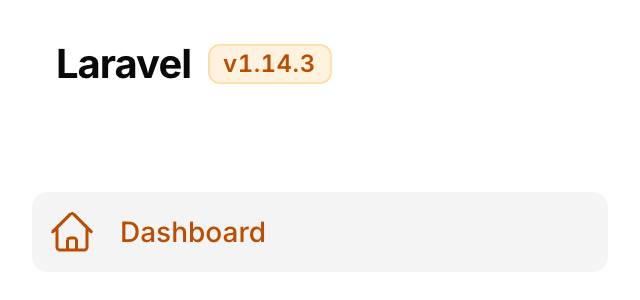

# Filament App Version

[](https://packagist.org/packages/vaslv/filament-app-version)
[](https://github.com/vaslv/filament-app-version/actions/workflows/tests.yml)
[](https://plumbphp.dev/vaslv/filament-app-version)

[English](README.md) · **Русский**

Плагин для [Filament 5](https://filamentphp.com), который показывает версию приложения небольшим чипом рядом с логотипом панели — в топбаре на десктопе и в шапке выдвижного сайдбара на мобильном, чтобы она была видна на любой ширине.


- 🔗 **Работает без настройки** — если в приложении уже есть `config('app.version')` или поле `version` в `composer.json`, достаточно установить пакет и зарегистрировать плагин
- 🧩 **Несколько источников с приоритетом** — выигрывает первый непустой
- 🎨 **Берёт цвет у вашей панели** — по умолчанию основной, по желанию нейтральный, в светлой и тёмной теме, без кастомной темы и пересборки Tailwind
- 🔒 **Скрыт от гостей по умолчанию** — номер сборки на публичной странице логина подсказывает атакующему, какие CVE пробовать; показать его можно одним явным вызовом

## Требования

- PHP 8.4+
- Laravel ^13.0
- Filament ^5.0

## Установка

```bash
composer require vaslv/filament-app-version
```

Зарегистрируйте плагин в панель-провайдере:

```php
use Vaslv\FilamentAppVersion\AppVersionPlugin;

public function panel(Panel $panel): Panel
{
    return $panel
        // ...
        ->plugin(AppVersionPlugin::make());
}
```

Это вся настройка. Публиковать конфиг нужно, только если требуется изменить цепочку:

```bash
php artisan vendor:publish --tag=filament-app-version-config
```

## Откуда берётся версия

Источники перебираются по порядку, выигрывает **первый непустой**:

```
1. config('filament-app-version.version')   ← env('APP_VERSION'), точка инжекта из CI
2. config('app.version')                    ← конвенция Laravel
3. composer.json → "version"
→  fallback 'dev'
```

Чтобы держать версию в репозитории, добавьте поле `version` в `composer.json` приложения и бампайте его при релизе — это третье звено, больше ничего не нужно.

### Инжект версии из CI

Выставьте `APP_VERSION` в окружении, и первое звено цепочки его подхватит:

```
APP_VERSION=1.19.16
```

**Не используйте для этого `EnvVersionResolver`.** Конфиг пакета вызывает `env('APP_VERSION')` *внутри конфиг-файла* — единственное размещение, которое переживает `php artisan config:cache`. При закешированном конфиге Laravel вообще не загружает `.env`, поэтому вызов `env()` в рантайме вернёт `null` на проде, прекрасно работая на локальной машине.

## Настройка

```php
use Filament\Panel;
use Filament\Support\Enums\Size;
use Filament\Support\Enums\VerticalAlignment;
use Filament\View\PanelsRenderHook;
use Vaslv\FilamentAppVersion\AppVersionPlugin;
use Vaslv\FilamentAppVersion\Resolvers\ConfigVersionResolver;
use Vaslv\FilamentAppVersion\Resolvers\FileVersionResolver;
use Vaslv\FilamentAppVersion\Resolvers\GitVersionResolver;

->plugin(
    AppVersionPlugin::make()
        ->resolvers([
            ConfigVersionResolver::make('app.release'),
            FileVersionResolver::make(base_path('VERSION')),
            GitVersionResolver::make(),
        ])
        ->fallback('dev')
        ->prefix('v')
        ->badge()
        ->neutral()
        ->size(Size::Small)
        ->verticalAlignment(VerticalAlignment::Center)
        ->renderHooks([
            PanelsRenderHook::TOPBAR_LOGO_AFTER,
            PanelsRenderHook::SIDEBAR_LOGO_AFTER,
        ])
        ->tooltip(fn (): string => __('Версия приложения'))
        ->visible(fn (Panel $panel): bool => auth()->user()?->can('viewAppVersion') ?? false)
        ->view('filament.my-own-chip')
        ->extraAttributes(['data-testid' => 'app-version']),
)
```

| Метод | По умолчанию | Примечание |
|---|---|---|
| `resolvers(array)` | глобальная цепочка | Переопределяет цепочку **только для чипа этой панели** |
| `fallback(?string)` | `'dev'` | `null` — не рендерить чип вовсе, если ничего не нашлось |
| `prefix(string)` | `'v'` | Не удваивается: версия, уже начинающаяся с `v`, остаётся как есть |
| `badge(bool)` | `false` | Рисует версию плашкой — с подложкой и волосяной рамкой — вместо голого текста |
| `neutral(bool)` | `false` | Нейтральный серый панели вместо основного цвета |
| `size(Size\|string)` | `Size::Medium` | `xs` … `xl`. Масштабирует текст, а вместе с ним и плашку — см. [Размер](#размер) |
| `verticalAlignment(VerticalAlignment\|string)` | `VerticalAlignment::Center` | `start`, `center` или `end` — см. [Положение по вертикали](#положение-по-вертикали) |
| `renderHooks(array)` | топбар + шапка сайдбара | Любые `PanelsRenderHook` — см. [Порядок хуков](#порядок-хуков) |
| `tooltip(string\|Closure\|null)` | переведённое «Версия приложения» | Становится атрибутом `title`. `null` убирает его вовсе, а не возвращает к значению по умолчанию. Если текст переводится, передавайте **замыкание** — см. ниже |
| `visible(bool\|Closure)` | только аутентифицированным | Последнее слово: перекрывает и дефолт, и `showToGuests()` |
| `showToGuests(bool)` | `false` | См. [Видимость](#видимость) |
| `view(string)` | чип пакета | См. [Своя вьюха](#своя-вьюха) |
| `extraAttributes(array)` | `[]` | `style` конкатенируется с обязательным, остальное перекрывает — см. ниже |

Замыкания, переданные в `visible()` и `tooltip()`, получают `Panel` первым аргументом; замыкания без параметров продолжают работать.

Передавайте в `tooltip()` замыкание всегда, когда текст переводится. Панель-провайдер выполняется один раз, до middleware локали и один раз на воркер Octane, поэтому голый `__()` заморозит один язык для всех пользователей.

### Оформление

По умолчанию чип — это голый текст **основным** цветом панели, тем же, которым Filament подсвечивает активный пункт меню. Два переключателя это меняют:

```php
AppVersionPlugin::make()->badge()     // плашка: подложка и волосяная рамка
AppVersionPlugin::make()->neutral()   // серый обычного пункта меню
```

| | Светлая | Тёмная |
|---|---|---|
| по умолчанию |  |  |
| `neutral()` |  |  |
| `badge()` |  |  |
| `badge()->neutral()` |  |  |

Панель на скриншотах передаёт в `->colors()` цвет `Color::Amber`; чип янтарный потому, что янтарная панель, а не потому, что пакет выбрал цвет.

`prefix()` — часть того же текста, по умолчанию `v`:

```php
AppVersionPlugin::make()->badge()->prefix('build ')
```


Ничего не захардкожено: цвета берутся из переменных `--primary-*` и `--gray-*` самой панели, поэтому чип следует за той палитрой, которую вы передали в `->colors()`. Светлый и тёмный оттенки выбирает CSS-функция `light-dark()` — она работает, потому что Filament объявляет `color-scheme` на тёмном корне, так что регистрировать класс и пересобирать стили не нужно.

### Размер

```php
use Filament\Support\Enums\Size;

AppVersionPlugin::make()->size(Size::Small)   // или ->size('sm')
```

Принимает `Size` самого Filament или его строковое значение.

| `size()` | Текст | Плашка, только с `badge()` |
|---|---|---|
| `xs` | `0.625rem` / `0.875rem` | padding `0 0.25rem`, радиус `0.25rem` |
| `sm` | `0.6875rem` / `1rem` | padding `0.0625rem 0.375rem`, радиус `0.25rem` |
| `md` **(по умолчанию)** | `0.75rem` / `1rem` — тейлвиндовский `text-xs`, тот же размер, что у `.fi-badge` самого Filament | padding `0.125rem 0.5rem`, радиус `0.375rem` |
| `lg` | `0.875rem` / `1.25rem` — `text-sm` | padding `0.25rem 0.625rem`, радиус `0.375rem` |
| `xl` | `1rem` / `1.5rem` — `text-base` | padding `0.375rem 0.75rem`, радиус `0.5rem` |

Все пять с включённым `badge()`, кадры одинаковые — ступени сравнимы:

| | |
|---|---|
| `xs` |  |
| `sm` |  |
| `md` |  |
| `lg` |  |
| `xl` |  |

`md` — ровно то, чем чип был до появления `size()`, поэтому обновление ничего не меняет, пока метод не вызван. Все отступы — токены тейлвиндовской шкалы spacing; два радиуса взяты у Filament — `rounded-md` на «бейджевых» ступенях и кнопочный `rounded-lg` на самой большой, — а два нижних это тейлвиндовский `rounded-sm`, на ступень меньше бейджа, потому что `0.375rem` на строке высотой `0.625rem` читается как лепёшка. Две ступени ниже `md` выходят за типографскую шкалу Tailwind — она заканчивается на `text-xs`, — но «меньше бейджа» и есть весь смысл `xs` рядом с логотипом.

Без `badge()` масштабируется только текст: плашки, которую можно было бы масштабировать, просто нет.

### Положение по вертикали

```php
use Filament\Support\Enums\VerticalAlignment;

AppVersionPlugin::make()->verticalAlignment(VerticalAlignment::Start)   // или ->verticalAlignment('start')
```

`start` прижимает чип вверх, `end` — вниз, `center` — значение по умолчанию. Ниже — шапка выдвижного сайдбара, где бокс фиксированные `4rem` и разница видна лучше всего:

| | |
|---|---|
| `start` |  |
| `center` **(по умолчанию)** |  |
| `end` |  |

Точкой отсчёта служит **строка, в которую чип отрендерился**, а не вся полоса целиком. В топбаре высота этой строки равна высоте логотипа, поэтому `start` выравнивает чип по верхнему краю логотипа. Шапка выдвижного сайдбара — фиксированные `4rem` (`.fi-sidebar-header` это `h-16`), поэтому там `start` и `end` прижимаются к её собственным краям: одна и та же настройка на десктопе смотрится плотнее, чем в мобильном ящике.

`center` не добавляет в разметку ничего: он рисует ровно то, что чип рисовал до появления этого метода, и расположение по-прежнему определяет контейнер — а в обоих дефолтных хуках это и есть середина. Пишут что-то только `start` и `end`: сдвинуть элемент вопреки `align-items` контейнера умеет один лишь `align-self`.

И пишут дважды — как `align-self` и как `vertical-align`, — потому что какое из объявлений живое, решает хук. Хук помещает чип в контейнер одного из трёх видов: **флекс-строка** (`.fi-topbar-start` и `.fi-sidebar-header`, оба дефолтных), **грид** (любой schema-хук, включая `AUTH_LOGIN_FORM_AFTER`: контейнер схемы Filament рисует своим же макросом `grid()`) или **блок** — это ваш собственный хук, рендерящий чип в текст. В первых двух чип двигает `align-self`, а `vertical-align` бездействует; в третьем наоборот. Каждое объявление бездействует там, где работает другое.

Есть и четвёртый контейнер, и это единственная оговорка: **флекс-колонка** — `.fi-sidebar-nav` и `.fi-sidebar`, на которых висят `SIDEBAR_NAV_START`, `SIDEBAR_NAV_END`, `SIDEBAR_START` и `SIDEBAR_FOOTER`, — читает `align-self` по *горизонтальной* оси. На таких хуках `start` и `end` двигают чип вбок, а не вверх-вниз. Такую ось им даёт CSS, и пакет тут ничего не решает; поэтому же `center`, который есть у каждого чипа без всякого вызова, не пишет ничего.

Нераспознанная строка в любом из двух методов игнорируется — остаётся прежнее значение — с предупреждением в лог при включённом `APP_DEBUG`. Опечатка в размере это косметика, и панель из-за неё пакет не роняет.

### `extraAttributes()` и экранирование

Значения и имена атрибутов попадают в HTML **без экранирования** — это поведение самого `ComponentAttributeBag` Laravel, и пакет от него не отходит. Значение с двойной кавычкой закрывает атрибут, поэтому экранируйте всё, что не является написанным вами литералом.

```php
// Нормально — литерал.
->extraAttributes(['data-testid' => 'app-version'])

// Экранируйте — значение пришло извне вашего кода.
->extraAttributes(['data-tenant' => e($tenant->name)])
```

`style` — способ перекрасить чип, для которого не нужна своя вьюха: здесь моноширинный чип, всё та же `badge()` в цвете панели.

```php
->badge()->extraAttributes(['style' => 'font-family:ui-monospace,SFMono-Regular,monospace;letter-spacing:0.02em'])
```


Два исключения: `style` вклеивается в собственный смерженный дефолт пакета, и его Laravel экранирует сам, а `tooltip()` идёт по экранируемому пути, поэтому `->tooltip($чтоТоНедоверенное)` безопасен.

### Источники

| Резолвер | Что читает |
|---|---|
| `ConfigVersionResolver::make('app.version')` | Значение конфига по dot-пути |
| `ComposerJsonVersionResolver::make()` | Поле `version` из `composer.json` приложения |
| `FileVersionResolver::make(base_path('VERSION'))` | Plain-text файл. Второй аргумент — `make(base_path('build.json'), 'version')` — переключает в режим JSON с dot-путём |
| `GitVersionResolver::make()` | Первые 7 символов SHA `HEAD`, прочитанные прямо из `.git` без вызовов шелла и без определения тега |
| `CallbackVersionResolver::make(fn () => …)` | Что угодно — Redis, Vault, таблица |
| `EnvVersionResolver::make('APP_RELEASE')` | Переменную окружения **процесса** — читайте предупреждение ниже |

`EnvVersionResolver` видит переменную, только если она действительно в окружении процесса: `environment:`/`env_file:` в compose, Deployment в Kubernetes, systemd-юнит. Переменная, живущая только в файле `.env`, ему не видна при закешированном конфиге — поэтому штатный путь для переменной окружения это конфиг пакета.

### Видимость

|  | гость | аутентифицирован |
|---|---|---|
| по умолчанию | скрыт | показан |
| `showToGuests()` | показан | показан |
| `visible(fn)` | результат замыкания | результат замыкания |

Если `visible()` задан вместе с `showToGuests()`, при включённом `APP_DEBUG` пишется warning, чтобы противоречие не пришлось угадывать.

Осторожный дефолт выбран потому, что хуки вроде `AUTH_LOGIN_FORM_AFTER` рендерятся до входа, а там точный номер сборки подсказывает атакующему, какие уязвимости пробовать.

### Порядок хуков

Два дефолтных хука дополняют друг друга по **брейкпоинту**, а не по состоянию меню: выше `64rem` Filament прячет шапку сайдбара, ниже — топбар. То есть на десктопе виден топбарный чип, на мобильном — тот, что в выдвижном сайдбаре, а копия в сайдбаре на десктопе попадает в DOM, но не рисуется.

| `TOPBAR_LOGO_AFTER` — десктоп | `SIDEBAR_LOGO_AFTER` — мобильный ящик |
|---|---|
|  |  |

На сайдбарном хуке пакет выводит вместе с чипом одно CSS-правило. Filament задаёт контейнеру логотипа в этой шапке `flex: 1 1 0%`, а `SIDEBAR_LOGO_AFTER` — последний ребёнок шапки, поэтому без правила чип оказывается у противоположного края, а не рядом с логотипом. Правило ездит вместе с чипом — ничего на других хуках, ничего когда чип скрыт, и никакой пересборки стилей — а адресуется к чипу через `data-filament-app-version`, атрибут, который есть у каждого чипа и которым вы можете пользоваться в своём CSS и тестах.

Вывод на общем хуке идёт в **порядке регистрации**, поэтому позиция `->plugin()` в цепочке панель-провайдера определяет, окажется чип до или после вывода другого плагина на том же хуке:

```php
->plugin(AppVersionPlugin::make())      // логотип → версия → меню
->plugin(TopbarMenuPlugin::make())
```

Поменяйте эти две строки местами — получите логотип → меню → версия.

### Своя вьюха

`->view()` полностью заменяет чип. Вьюха получает ровно четыре переменные, и этот набор покрыт семвером:

| Переменная | Тип | Примечание |
|---|---|---|
| `$version` | `string` | Ровно то, что дал источник, с обрезанными пробелами |
| `$prefix` | `string` | Уже вычислена — пуста, если отключена или если `$version` с неё начинается |
| `$tooltip` | `?string` | Тот `title`, что реально попал в разметку, либо `null` |
| `$attributes` | `ComponentAttributeBag` | Ваши `extraAttributes()`, смерженные со `style` и `data-filament-app-version` пакета, плюс `title`, если подсказка задана |

```blade
<span {{ $attributes }}>{{ $prefix }}{{ $version }}</span>
```

**Чтобы просто перекрасить, `->view()` не нужен вовсе** — [`size()`](#размер) и [`verticalAlignment()`](#положение-по-вертикали) закрывают два самых частых случая, а `->extraAttributes(['style' => 'font-size:0.7rem;'])` перекрывает объявления пакета для всего остального. Внутри своей вьюхи `{{ $attributes->except('style') }}` уберёт оформление пакета, а вместе с ним и то, что вы передали через `extraAttributes(['style' => …])`.

Вьюха пакета выводит ещё и скрытое `«<подсказка>: »` перед версией: чип — неинтерактивный `<span>`, до его `title` не добраться с клавиатуры. Своя вьюха без этой строки озвучит скринридеру голое `v1.19.16`.

Печатайте `{{ $attributes }}` на самом элементе чипа или хотя бы сохраните на нём `data-filament-app-version`: [правило для шапки сайдбара](#порядок-хуков) выбирает чип по этому атрибуту, и своя вьюха без него снова отправит чип к дальнему краю мобильного ящика.

## Версия вне панели

```php
use Vaslv\FilamentAppVersion\Facades\AppVersion;

AppVersion::get(); // '1.19.16' или null
```

Удобно как cache-buster темы:

```php
->theme(asset('css/filament/admin/theme.css').'?v='.AppVersion::get())
```

Фасад всегда читает **глобальную** цепочку из конфига, а не `->resolvers()` панели: в примере выше `->theme()` выполняется раньше `->plugin()`, то есть на момент вызова плагина ещё не существует.

## Тесты и качество кода

```bash
composer check       # lint:test + analyse + test
composer test        # Pest
composer analyse     # PHPStan, level max
composer lint        # Pint, с исправлением
```

`composer.lock` не коммитится, поэтому каждый прогон разрешает зависимости заново. Чтобы воспроизвести CI без локального PHP:

```bash
make test            # одна версия PHP, по умолчанию 8.4
make test-matrix     # 8.4 и 8.5, старшие и младшие зависимости, в Docker
```

CI гоняет те же четыре комбинации плюс Pint и PHPStan.

## Изменения

См. [CHANGELOG.md](CHANGELOG.md).

## Автор

- [Andrei Vasilev](https://github.com/vaslv)

## Лицензия

MIT. См. [LICENSE](LICENSE).
